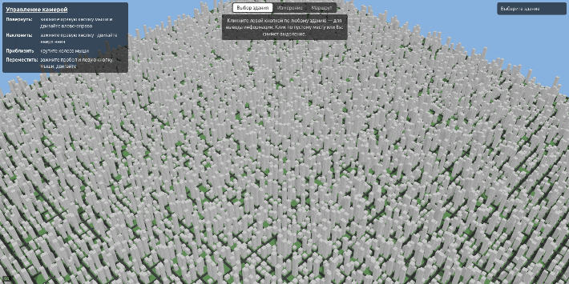

# WebGL2 City

Процедурный 3D-город на чистом **WebGL2**: тени, инстансинг, орбитальная камера, выбор зданий, измерение расстояний с прилипанием и навигатор кратчайшего пути A*.

Одно ядро без фреймворка и два приложения на равных — **Angular** и **React**.

**Демо:** [выбор версии](https://tmot24.github.io/webgl-city/) · [Angular](https://tmot24.github.io/webgl-city/angular/) · [React](https://tmot24.github.io/webgl-city/react/)



---

## Устройство

```
packages/
  core/      ядро: генерация города, WebGL2-рендер, камера, лучи, A*, данные для UI — без фреймворка
  styles/    общие стили интерфейса поверх сцены
apps/
  angular/   Angular 22: zoneless, сигналы, @ngrx/signals
  react/     React 19: MobX 7
```

Вся логика сцены живёт в ядре в одном экземпляре. Приложения — тонкие адаптеры: связывают ядро со своей реактивностью и жизненным циклом и рисуют интерфейс. Ресурсы ядра возвращают свою очистку, а рендер принимает кадр как данные, поэтому одно и то же ядро одинаково ложится и на сигналы, и на MobX.

| Пакет | Подробнее |
| --- | --- |
| Ядро | [packages/core](packages/core) |
| Angular | [apps/angular](apps/angular) |
| React | [apps/react](apps/react) |

---

## Angular и React

| | Angular | React |
| --- | --- | --- |
| Состояние | `signalStore`, иммутабельный `patchState` | классы `makeAutoObservable`, мутации в action |
| Производные значения | `computed`, кэш всегда | геттеры-`computed`, кэш, пока наблюдаются |
| Подписка рендера на состояние | `afterRenderEffect` — внутри цикла Angular | `reaction` + rAF — вне React |
| Скоуп сторов | `providers` компонента сцены | `useState` в сцене + Context |
| Зависимости фич | DI: `injectRoute()` | параметры: `useRoute({ ... })` |
| Метки поверх сцены | host-элемент + `afterRenderEffect`, без change detection | `ref` + `reaction`, без ре-рендеров |

---

## Управление

| Действие | Как |
| --- | --- |
| Повернуть камеру | правая кнопка мыши + движение |
| Наклонить | правая кнопка мыши вверх/вниз |
| Приблизить/отдалить | колесо мыши |
| Переместить (пан) | пробел + левая кнопка мыши |
| Выбрать инструмент | переключатель режимов сверху |
| Сбросить действие режима | Esc |

Режимы: **выбор здания** (клик → информация), **измерение** (два клика → расстояние, точки прилипают к углам зданий и перекрёсткам), **маршрут** (две точки на дорогах → кратчайший путь).

---

## Запуск

Требуемая версия Node.js указана в `devEngines` корневого `package.json`.

```bash
npm install

npm run start:angular   # Angular, dev-сервер
npm run start:react     # React, dev-сервер Vite

npm run build:angular   # prod-сборка Angular
npm run build:react     # проверка типов + prod-сборка React
```

Оба приложения публикуются на GitHub Pages одним workflow: Angular в `/angular/`, React в `/react/`, в корне — страница выбора версии.
